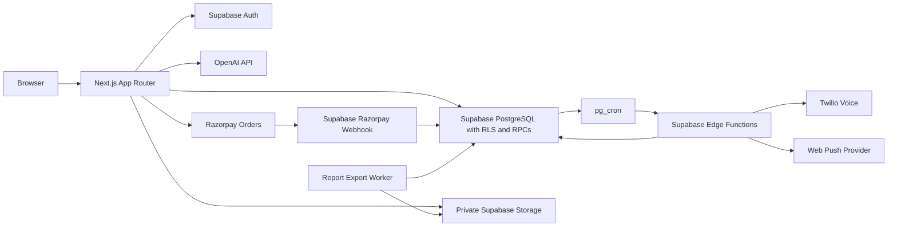

# Infrastructure and deployment

Cheque Check combines a Next.js application, Supabase Auth/PostgreSQL/Storage/Edge Functions, and external providers. The repository defines how these parts connect, but it does not prove that a hosted deployment has matching secrets, migrations, cron jobs, or provider settings ([runtime entry points](../package.json#L37-L40), [environment setup](environment-and-secrets.md#deployment-state)).

## Quick path

1. Confirm the target environment and credentials without printing secrets; preview builds must use QA destinations ([environment rules](environment-and-secrets.md#L1-L30), [public environment validation](../src/lib/env/schema.ts#L64-L109)).
2. Build the Next.js app using Node.js `>=22.12.0 <23` and its committed dependency lockfile ([runtime](../package.json#L1-L8), [package scripts](../package.json#L9-L24)).
3. Apply forward database migrations before deploying code that depends on their schema, then deploy Edge Functions separately ([migration scripts](../package.json#L25-L40), [function deploy command](../package.json#L37-L40)).
4. Set provider secrets in their designated Supabase Auth, Edge Function, or hosting secret store ([environment groups](environment-and-secrets.md#L21-L34)).
5. Verify the hosted callback, storage, worker, cron, and provider paths in the target environment; local tests alone do not prove hosted readiness ([QA limits](../e2e/README.md#L143-L153), [deployment verification](#deployment-verification)).

## Service topology

The browser/server application uses cookie-aware Supabase clients; the admin client is separate and server-only ([server client](../src/lib/supabase/server.ts#L6-L24), [admin client](../src/lib/supabase/admin.ts#L1-L12)). The OCR route authenticates and checks the request before invoking the provider workflow ([OCR route](../src/app/api/ocr/cheque/route.ts#L37-L80)). Payment orders are created by the authenticated application route and verified/fulfilled by the Razorpay webhook ([create-order route](../src/app/api/payments/create-order/route.ts#L30-L60), [webhook](../supabase/functions/razorpay-webhook/handler.ts#L30-L81)).

PostgreSQL stores job state and invokes reminder and export Edge Functions through scheduled HTTP calls. Notification cron reads Vault credentials, and the export worker schedule is created inactive in the migration ([notification cron calls](../supabase/migrations/20261017000000_notification_platform.sql#L153-L191), [export cron state](../supabase/migrations/20261031040000_background_exports.sql#L217-L234)). Private media and exports are delivered through owner-checked routes or policies rather than public buckets ([media authorization](../src/app/api/storage/%5Bbucket%5D/%5B...path%5D/route.ts#L14-L61), [export storage policy](../supabase/migrations/20261031040000_background_exports.sql#L29-L55)).

## Deployable units

- **Web app:** Next.js App Router, API routes, and browser assets; package scripts expose build/start and require Node.js `>=22.12.0 <23` ([package runtime and scripts](../package.json#L1-L24)). The Next.js config includes Sentry runtime-injection/core files in output tracing and enables Sentry build-time instrumentation; verify the deployed build artifact when changing this integration ([Sentry tracing and instrumentation](../next.config.ts#L35-L46), [Sentry build configuration](../next.config.ts#L67-L82), [Sentry dependency](../package.json#L52-L60)).
- **Database:** schema, constraints, RLS, business RPCs, and scheduled job definitions are versioned in Supabase migrations ([lifecycle migration](../supabase/migrations/20261021000000_lifecycle.sql#L36-L76), [migration procedures](../scripts/README.md#L70-L125)).
- **Edge Functions:** scheduler, dispatcher, Razorpay webhook, and report-export worker are deployed by a separate package command ([deploy script](../package.json#L37-L40)).
- **Providers:** OpenAI, Razorpay, Twilio, VAPID push, Sentry, and Clarity have distinct environment/configuration requirements ([environment map](environment-and-secrets.md#L21-L34)).

## Deployment verification

### Automatic production releases

[Production Release](../.github/workflows/production-release.yml) runs on pushes/merges to `main` and supports manual retries from `main`. One production release runs at a time; an active migration is never canceled by a newer push. GitHub may replace an older pending run with a newer one. The selected commit includes all forward migrations required by that release.

The workflow uses the existing guarded `db:migrate --env prod --confirm-ref` CLI command, without resets or seed reloads. Migration failure blocks its deployment step. After successful migration, [the deployment script](../scripts/production-deploy.mjs) requests a Vercel production deployment pinned to the exact migrated Git SHA, and waits for `READY`; API errors, build failures, mismatched commits, and timeouts fail the workflow. Vercel's existing project environment values supply the application build/runtime configuration. Edge Functions are not deployed by this workflow.

[Vercel Git configuration](../vercel.json) disables automatic deployments from `main` so Git-triggered builds cannot race migrations; other branches retain their existing behavior. Do not bypass this gate with manual production deploys or independent deploy hooks. Quality remains an independent workflow by release-owner choice: production release is gated on migration success, not the Quality job or E2E result.

Configure the GitHub `production` environment with secrets `PROD_SUPABASE_URL`, `PROD_SUPABASE_DB_URL`, and `VERCEL_TOKEN`, plus variables `PROD_SUPABASE_PROJECT_REF`, `VERCEL_PROJECT_ID`, `VERCEL_TEAM_ID`, and numeric `VERCEL_REPO_ID`. Database and API URLs must identify the confirmed production project. Never place database URLs, passwords, or Vercel tokens in workflow source or command-line arguments. Restrict the environment to `main` and use a least-privilege Vercel credential; rotate it if revoked or expired.

Forward schema changes must remain compatible with the currently deployed app while migrations run. Take and verify backups before risky migrations. A successful migration followed by a failed deployment is not rolled back automatically: inspect the failed run and Vercel before retrying the latest `main` release. Production readiness still requires the application/provider smoke tests below.

The package deploy command invokes `supabase functions deploy razorpay-webhook` without `--no-verify-jwt`, while the Razorpay handler validates the provider HMAC signature itself ([deploy command](../package.json#L37-L40), [HMAC validation](../supabase/functions/razorpay-webhook/handler.ts#L30-L50)). This is a repository-level deployment mismatch to resolve: confirm the deployed Supabase gateway setting allows the provider request to reach the handler, then verify the signed webhook in QA. The actual hosted setting is unknown from this checkout.

The public-contact limiter hashes forwarded address headers, and its behavior requires the production proxy to set those headers from the actual client address ([contact route](../src/app/api/contact/route.ts#L47-L64), [contact deployment requirement](public-site-and-feedback.md#proxy-requirement)). The deployment platform is not established by repository code; the E2E guide also identifies external deployment settings as a separate gate ([deployment boundary](../e2e/README.md#L115-L131)).
