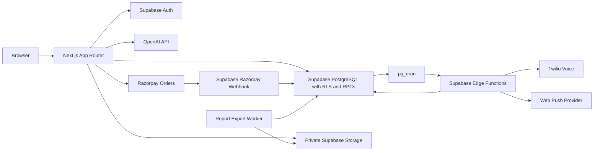

# Infrastructure and deployment

Cheque Check combines a Next.js application, Supabase Auth/PostgreSQL/Storage/Edge Functions, and external providers. The repository defines how these parts connect, but it does not prove that a hosted deployment has matching secrets, migrations, cron jobs, or provider settings ([runtime entry points](../package.json#L37-L40), [environment setup](environment-and-secrets.md#deployment-state)).

## Quick path

1. Confirm the target environment and credentials without printing secrets; preview builds must use QA destinations ([environment rules](environment-and-secrets.md#L1-L30), [public environment validation](../src/lib/env/schema.ts#L64-L109)).
2. Build the Next.js app using Node 22 and its committed dependency lockfile ([runtime](../package.json#L1-L8), [package scripts](../package.json#L9-L24)).
3. Apply forward database migrations before deploying code that depends on their schema, then deploy Edge Functions separately ([migration scripts](../package.json#L25-L40), [function deploy command](../package.json#L37-L40)).
4. Set provider secrets in their designated Supabase Auth, Edge Function, or hosting secret store ([environment groups](environment-and-secrets.md#L21-L34)).
5. Verify the hosted callback, storage, worker, cron, and provider paths in the target environment; local tests alone do not prove hosted readiness ([QA limits](../e2e/README.md#L143-L153), [deployment verification](#deployment-verification)).

## Service topology

The browser/server application uses cookie-aware Supabase clients; the admin client is separate and server-only ([server client](../src/lib/supabase/server.ts#L6-L24), [admin client](../src/lib/supabase/admin.ts#L1-L12)). The OCR route authenticates and checks the request before invoking the provider workflow ([OCR route](../src/app/api/ocr/cheque/route.ts#L37-L80)). Payment orders are created by the authenticated application route and verified/fulfilled by the Razorpay webhook ([create-order route](../src/app/api/payments/create-order/route.ts#L30-L60), [webhook](../supabase/functions/razorpay-webhook/handler.ts#L30-L81)).

PostgreSQL stores job state and invokes reminder and export Edge Functions through scheduled HTTP calls. Notification cron reads Vault credentials, and the export worker schedule is created inactive in the migration ([notification cron calls](../supabase/migrations/20261017000000_notification_platform.sql#L153-L191), [export cron state](../supabase/migrations/20261031040000_background_exports.sql#L217-L234)). Private media and exports are delivered through owner-checked routes or policies rather than public buckets ([media authorization](../src/app/api/storage/%5Bbucket%5D/%5B...path%5D/route.ts#L14-L61), [export storage policy](../supabase/migrations/20261031040000_background_exports.sql#L29-L55)).

## Deployable units

- **Web app:** Next.js App Router, API routes, and browser assets; package scripts expose build/start and the manifest constrains the Node major version ([package runtime and scripts](../package.json#L1-L24)).
- **Database:** schema, constraints, RLS, business RPCs, and scheduled job definitions are versioned in Supabase migrations ([lifecycle migration](../supabase/migrations/20261021000000_lifecycle.sql#L36-L76), [migration procedures](../scripts/README.md#L70-L125)).
- **Edge Functions:** scheduler, dispatcher, Razorpay webhook, and report-export worker are deployed by a separate package command ([deploy script](../package.json#L37-L40)).
- **Providers:** OpenAI, Razorpay, Twilio, VAPID push, Sentry, and Clarity have distinct environment/configuration requirements ([environment map](environment-and-secrets.md#L21-L34)).

## Deployment verification

The package deploy command invokes `supabase functions deploy razorpay-webhook` without `--no-verify-jwt`, while the Razorpay handler validates the provider HMAC signature itself ([deploy command](../package.json#L37-L40), [HMAC validation](../supabase/functions/razorpay-webhook/handler.ts#L30-L50)). This is a repository-level deployment mismatch to resolve: confirm the deployed Supabase gateway setting allows the provider request to reach the handler, then verify the signed webhook in QA. The actual hosted setting is unknown from this checkout.

The public-contact limiter hashes forwarded address headers, and its behavior requires the production proxy to set those headers from the actual client address ([contact route](../src/app/api/contact/route.ts#L47-L64), [contact deployment requirement](public-site-and-feedback.md#proxy-requirement)). The deployment platform is not established by repository code; the E2E guide also identifies external deployment settings as a separate gate ([deployment boundary](../e2e/README.md#L115-L131)).
