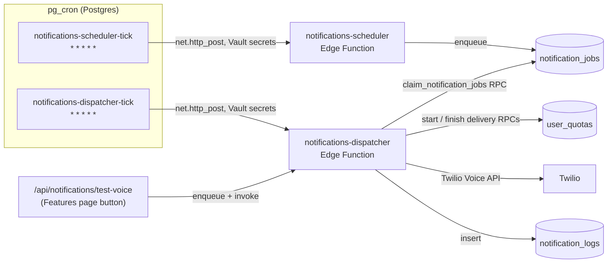

# Notification system

How Cheque Check delivers Voice Reminder calls (and the sample test-call
feature), what user preferences it respects, how the scheduler/dispatcher
pipeline works, and how to troubleshoot it. Covers the Voice channel shipped
today; Email/Push/WhatsApp are planned follow-ups built on the same schema.

## 1. Architecture overview



- **notifications-scheduler** (`supabase/functions/notifications-scheduler/`) runs every
  minute and resumes durable 15-minute scheduling windows. Its SQL RPC processes
  200 eligible profiles per batch, applies local-time slots and due-cheque rules,
  and enqueues one `notification_jobs` row per business.
- **notifications-dispatcher** (`supabase/functions/notifications-dispatcher/`) runs every
  minute. It claims five jobs at a time, processes at most five calls concurrently per invocation,
  and drains up to 200 jobs within a 40-second invocation budget. A ten-second
  provider deadline bounds each call; database/network latency can reduce throughput.
- Both are plain Deno Edge Functions with **no shared npm deps** — Twilio is
  called via raw `fetch` (works identically whether deployed via the CLI or
  pasted into the Supabase Dashboard editor, since the Dashboard can't resolve
  cross-function imports from `supabase/functions/_shared/`).
- `pg_cron` calls both functions via `net.http_post`, reading the project URL
  and service-role key from **Supabase Vault** (not hardcoded — see
  `supabase/migrations/20261017000000_notification_platform.sql`).

## 2. Data model

### Read-only capacity diagnostics

After applying `20261031030000_notification_health.sql`, run
`npm run ops -- ops notification-health --env qa --json` for exact queue counts,
oldest due age, expired leases, unresolved reservations, and scheduler lag.
Use `--check` for a nonzero exit when configured alert thresholds are exceeded.
This is a single service-only aggregate query; it never places calls, advances
the scheduler, retries jobs, changes quotas, or returns personal data.

The updated workers emit aggregate JSON events `notification.scheduler.run`
and `notification.dispatcher.run` to existing Edge logs, including duration,
batch/outcome counts, checkpoint pauses, and finalization/reconciliation signals.
These complement the durable database health query when a worker terminates
before it can emit its final event. No external dashboard or alert poller is
automatically installed. See [monitoring and session lookup](monitoring-and-session-lookup.md#scaling-validation-and-capacity-gates)
for metric definitions, local benchmark commands, and production capacity gates.

| Table                | Purpose                                                                                                                                                                                             |
| -------------------- | --------------------------------------------------------------------------------------------------------------------------------------------------------------------------------------------------- |
| `notification_jobs`  | The queue. One row per (business, channel, day, slot) for real reminders, or one row per sample test call. `idempotency_key` prevents duplicate enqueues across overlapping scheduler ticks.        |
| `notification_logs`  | Immutable delivery audit trail — one row per dispatch attempt that actually reached a provider (Twilio), with `provider_message_id` (Twilio Call SID) for cross-referencing Twilio's own Call Logs. |
| `push_subscriptions` | Reserved for the future Web Push channel (not wired up yet).                                                                                                                                        |
| `user_quotas`        | Shared with the rest of the monetization system. `feature_id = 'voice_reminder'` is the quota pool both real reminders **and** sample test calls draw from.                                         |

`channel`, `status` and `purpose` are PostgreSQL enums after the closed-choice
migration. `notification_attempts` records token-owned provider attempts, and
`notification_scheduler_runs` stores resumable profile cursors.

## 3. User preferences the system respects

On the Features page, Voice Reminder access, the daily-call switch, and phone
setup are separate controls. Users with subscription or trial credits can
configure their phone even while daily calls are off. Phone edits require
**Save phone number**; test calls stay disabled until the saved number is valid,
the service is on, and call credits remain. Switching calls off does not pause
the paid access period. Test calls consume the same quota as scheduled calls.

The page also shows remaining credits, subscription access dates, and eligible
top-ups. **Purchases & activation** lists recent payment orders and their actual
transaction statuses. **Refresh status** reloads payments, entitlements, and
quotas; checkout success alone is not treated as confirmed feature activation.

| Preference              | Column                                                                                                    | Where it's used                                                                                                                                                                      |
| ----------------------- | --------------------------------------------------------------------------------------------------------- | ------------------------------------------------------------------------------------------------------------------------------------------------------------------------------------ |
| Phone number            | `profiles.phone`                                                                                          | Dispatcher refuses to call if null; Scheduler skips the profile entirely if null                                                                                                     |
| Voice Reminders enabled | `profiles.voice_call_enabled`                                                                             | Scheduler only considers profiles with this `= true`                                                                                                                                 |
| Time zone               | `profiles.time_zone`                                                                                      | Scheduler computes the profile's **local** wall-clock time via `Intl.DateTimeFormat` — every user gets reminders at their own 9am/1pm/6pm, not a fixed UTC time                      |
| Reminders per day       | `profiles.reminders_per_day` (1/2/3)                                                                      | Maps to 1, 2, or 3 slot times per day (`REMINDER_SLOTS` in `_shared/notifications.ts`) — repeats the reminder at each slot on the due day until the cheque is marked Cleared/Bounced |
| Voice language          | `profiles.language` (`en`/`hi`/`hi-en`)                                                                   | Reminder and sample-call text use the selected language; `hi-en` uses mixed Hindi-English text and the Hindi-capable voice                                                           |
| Display currency        | `profiles.currency` (`₹`/`$`/`€`/`£`)                                                                     | Reminder totals are formatted using the profile's display currency; payment transaction currencies remain their actual recorded currencies                                           |
| X-days-before           | `cheques.remind_before_days` (set from `profiles.default_reminder_days` at creation, editable per cheque) | Scheduler computes `daysUntilDue = deposit_date - today`; fires once `0 <= daysUntilDue <= remind_before_days`                                                                       |
| Due date                | `cheques.deposit_date` (falls back to `cheques.cheque_date` if no deposit date set)                       | The countdown target. If `deposit_date` is null, the system falls back to same-day-only on `cheque_date` (no "before" reference exists in that case)                                 |
| Cheque status           | `cheques.status`, `is_draft`                                                                              | Only `status = 'Issued'` and `is_draft = false` cheques are considered — Received (inward) cheques don't need a "fund your account" call                                             |

**Preferences not used to render Voice Reminders** (by design): `reduce_motion`,
`received_cheques_enabled`, `party_sms_enabled`, `date_format`, and
`time_format`. Calls contain no rendered calendar date or clock time; the
scheduler uses `time_zone` to determine each user's local date and reminder
slots. Report exports are machine-readable: CSV/JSON preserve ISO date values
and raw numeric cheque amounts rather than applying profile display formats.

## 4. Scheduler logic in detail

1. Claim the oldest incomplete scheduling window, or create the current
   15-minute window. Each SQL batch is serialized with a transaction advisory lock.
2. Read the next 200 eligible profiles in user-ID order. Compute local dates
   and slot times using PostgreSQL's timezone database; invalid zones are counted
   and reported explicitly.
3. Select due live, published Issued cheques and enqueue jobs with unique keys.
   Persist the cursor atomically with the inserts. Repeated batches do not create
   duplicate reminders.
4. Continue within the invocation's 40-second budget. Subsequent cron ticks resume
   the same window, including its original timestamp and force-run setting.

Slots remain 1 → `[09:00]`, 2 → `[09:00,17:00]`,
3 → `[09:00,13:00,18:00]`, with a 15-minute matching window. The normal
scheduler performs set-based selection and inserts, not one network query
per profile. Targeted ops runs retain the same due rules and explicit complete
pagination. The timezone-name materialized view avoids repeated catalog scans;
refresh `public.notification_time_zones` after PostgreSQL/tzdata upgrades.

## 5. Dispatcher logic in detail

1. Claim at most five due jobs using `FOR UPDATE SKIP LOCKED`. Each claim
   increments attempts and obtains a random ownership token and two-minute lease.
   Manual `p_user_id`/`p_job_ids` scopes remain enforced inside the SQL claim.
2. Check profile, phone, voice preference, business and live cheques; skip
   ineligible jobs using the ownership token, without consuming credits.
3. Build the message, then `admit_notification_delivery` atomically checks the
   shared provider gate, reserves one credit, and records that a request may begin.
   Initial limits are one admission/second and five request slots globally.
   Capacity denial returns the job to pending with 15-second backoff, no charge,
   no provider attempt, and no retry penalty. Dispatcher results say `queued`,
   not `sent` or `failed`. Workers wait at most one second between throttled batches
   within the existing 40-second loop budget instead of busy-spinning.
   A lost reservation
   response is treated conservatively: no provider call and no immediate retry.
4. Begin Twilio only before the admission's 20-second start deadline, then apply
   a ten-second HTTP deadline. An expired admission is settled as a confirmed
   non-send/rejection and refunded; no provider call is made.
   A usable accepted Call SID is required.
   HTTP 4xx rejection is definitive; network errors, malformed acceptance and
   HTTP 5xx are uncertain and must not cause blind redelivery.
5. `finish_notification_delivery` atomically settles status, quota and audit:
   acceptance charges the reserved credit once; rejection releases it and retries
   after 10 or 30 minutes, with at most three claimed attempts. Repeating the same
   finalization token is idempotent. Database finalization is retried, never the
   provider request itself. Acceptance/rejection also releases the global request
   slot transactionally. Uncertain calls/crashed workers conservatively hold slots
   until their two-minute capacity lease expires or an operator settles a known
   acceptance/rejection.
6. Expired unstarted leases are retryable. Started expired leases and uncertain
   provider outcomes become failed/reconciliation-required and retain the credit
   reservation. They are not automatically redelivered.

### Deployment and reconciliation

Pause both notification cron jobs and wait for existing invocations to finish
before applying the initial bounded-read/delivery/scheduler `20261031` migrations. Existing legacy `processing`
jobs are quarantined as failed because their provider outcomes cannot be inferred.
Deploy both updated Edge Functions before resuming cron; do not run old workers
against the new delivery schema. The migrations change both cron schedules to
every minute but do not activate paused jobs.

Investigate uncertain attempts with the provider's call records before acting.
For a known accepted call, a service-role operator can call
`finish_notification_delivery(job_id, claim_token, 'accepted', call_sid, NULL)`.
For a confirmed rejection/no call, use outcome `'rejected'` and a reason.
Never manually set an uncertain job back to pending: that bypasses settlement and
can duplicate calls. Legacy jobs have no new attempt token and require separate
manual provider/accounting review.

A pending reservation temporarily reduces available credits. Rejection refunds
only the original quota period; it never decrements usage in a newer period.
Monitor oldest pending age, expired processing leases, uncertain attempts and
reservation age. The global defaults are conservative, not proof of 10,000-user
capacity: tune against provider account limits and measured latency.

### Shared provider-capacity rollout

`20261031050000_notification_provider_capacity.sql` installs the service-only
gate, request-slot leases and read-only `notification_provider_health()` RPC.
Before applying it, pause dispatch cron and block manual/test dispatch while
existing invocations drain. Deploy the updated dispatcher and test-call route
before resuming traffic. The legacy `start_notification_delivery` RPC intentionally
fails closed; the renamed quota helper is not executable by the service role, so
old workers cannot bypass capacity limits. Do not deploy old worker code as a
rollback without coordinating the database contract.

Verify in approved QA that overlapping cron, manual and sample invocations cannot
bypass pacing or five request slots. Test capacity denial without credit/retry
loss, all accepted/rejected/uncertain outcomes, terminated workers, stale tokens,
quota exhaustion and expiry. Local tests apply the actual migration in PGlite;
PGlite serializes one connection and does **not** prove independent hosted
transaction contention or provider throughput.

Operators can inspect the limits/occupancy without sending calls:

```sh
npm run ops -- ops notification-provider-health --env qa --json
npm run ops -- ops notification-provider-health --env prod --check --json
```

`--check` exits 1 for expired slot rows; ordinary saturation is informational, not
an error. Combine with `ops notification-health` to alert on queue delay. The gate
prunes expired slots on subsequent admissions. `throttled_total` is a cumulative
count of admission denials (including repeat deferrals), not a unique-user metric.
No cron/alert delivery is installed by these read-only commands.

Limits reside in the single `notification_provider_capacity` row. Change them
only after approved provider/QA measurements, e.g. a reviewed service-role SQL
update of `starts_per_second` and `max_in_flight`; defaults are 1 and 5, with
schema-validated ranges `(0,100]` and `1..100`. Every worker shares the same row,
not a process-local counter. Missing configuration fails explicitly.

Pacing governs **database admissions**; network scheduling can shift actual HTTP
request start times. Slots count admitted/in-progress requests, not ringing or
answered phone calls, and expired leases cannot prove the remote provider has
finished an uncertain request. Twilio's account CPS/concurrent-call settings remain
the final provider-side limits. Clock-synchronized workers must honor the returned
start deadline; test host clock/latency in QA. The application gate does not claim
to enforce an exact on-wire CPS or limit the duration of calls.

At five in-flight requests with ten-second latency the rough ceiling is
0.5 requests/second while active, before database/preparation/settlement work and
uncertainty holds. A single 40-second cron invocation each minute has additional
idle time. Measure backlog/delivery SLOs before adding worker ticks or increasing
limits. There is no hard global queue-size cap or automatic provider reconciliation
in this phase; durable queued work is delayed, not silently dropped.

## 6. Sample / test-call feature

Users can trigger a real voice call to themselves from the **Features** page
(Voice Reminder add-on card → "Send test call" button), to verify their setup
works before relying on it.

- **Only available** once Voice Reminders is already toggled on and a valid
  phone number is set (same gate as real reminders use) — this intentionally
  prevents testing a configuration that wouldn't actually receive reminders.
- **Counts against the same `voice_reminder` quota** as real reminders — no
  separate "test" allowance.
- **Rate-limited** to 1 request per 5 minutes per user (reuses the existing
  `consume_api_rate_limit` RPC, same mechanism as the payment-order endpoint)
  to prevent accidental double-click spam burning quota/Twilio cost.
- **Dispatched synchronously**: `POST /api/notifications/test-voice`
  (`src/app/api/notifications/test-voice/route.ts`) enqueues a
  `notification_jobs` row with `purpose: 'sample_voice_test'` and a random
  (never-colliding) `idempotency_key`, then immediately invokes the deployed
  `notifications-dispatcher` function scoped to this user/job and reads back its status —
  the user gets a real pass/fail result in the UI within a few seconds instead
  of waiting for the next cron tick when capacity is available. Under global
  backpressure the existing UI explicitly reports queued; cron later resumes it.
  A test request never drains unrelated users' reminders.
- The dispatcher recognizes `purpose === 'sample_voice_test'` and builds a
  **canned test message** ("Hello {name}, this is a test call from Cheque
  Check...") instead of fetching real cheques — see
  `DispatcherOrchestrator.buildSampleMessage()`.

## 7. Hardcoded-value audit (what can safely change vs. what can't)

**Already dynamic / DB-driven (safe to change via the dashboard or
`payment_products` table without a code deploy):** product pricing, which
products are `active`, `entitlement_days`, `quota_increment` — the
`/api/payments/create-order` route reads all of these from the
`payment_products` table at request time.

**Found hardcoded as raw string literals in 5+ independent places** (the
exact concern this review was asked to check): `voice_reminder`,
`voice_reminder_sub`, `voice_reminder_30d`, `voice_reminder_100`, and their
`ai_scan`/`lifetime_premium` siblings were separately retyped in
`src/app/(dashboard)/features/page.tsx`, `src/lib/payments.ts`,
`src/features/monetization/lib/payment-product-icons.ts`, and
the old `scripts/admin-monetization.ts` (each with its **own** duplicated
`FeatureType`/product-id list). A future rename in one place without updating
the others would fail silently (e.g. a Razorpay button calling a `productId`
that no longer exists in `payment_products`).

**Fix applied**: `src/features/monetization/constants.ts` is now the single
source of truth (`FEATURE_IDS`, `PRODUCT_IDS`, `ENTITLEMENT_STATUS` +
derived arrays/zod schema), imported by all of the above. The Postgres enum
values themselves (`feature_type`, `entitlement_status`) still require a
migration to change — that's unavoidable — but the _application-layer_
duplication is gone. The Deno edge functions (which can't import from `src/`)
have their own minimal mirror: `supabase/functions/_shared/feature-ids.ts`
(just the one value they need, `voice_reminder`), with a comment pointing
back to the canonical source.

**Intentionally NOT made dynamic**: notification channel/status/purpose are
closed PostgreSQL enums after `20261021010000_closed_choices.sql`. Adding a
channel or purpose requires a migration and matching application contracts.

## 8. Required secrets / configuration

| Secret                                                            | Where                                                 | Purpose                                                                                                                                                            |
| ----------------------------------------------------------------- | ----------------------------------------------------- | ------------------------------------------------------------------------------------------------------------------------------------------------------------------ |
| `TWILIO_ACCOUNT_SID` / `TWILIO_AUTH_TOKEN` / `TWILIO_FROM_NUMBER` | Edge Function secrets                                 | Twilio API credentials + caller ID                                                                                                                                 |
| `NOTIFICATIONS_TEST_MODE` / `NOTIFICATIONS_TEST_PHONE`            | Edge Function secrets                                 | When `true`, **every** outbound voice call (including real reminders!) is redirected to `NOTIFICATIONS_TEST_PHONE`. Turn off before relying on real user delivery. |
| `NOTIFICATIONS_FORCE_RUN`                                         | Edge Function secret (scheduler only)                 | Testing-only: bypasses the slot-time window so a manual test run doesn't have to wait for 09:00/13:00/18:00 local time. Leave unset/`false` in normal operation.   |
| Vault secret `project_url`                                        | `select vault.create_secret(url, 'project_url')`      | Lets `pg_cron` build the function URL without hardcoding it in a migration                                                                                         |
| Vault secret `service_role_key`                                   | `select vault.create_secret(key, 'service_role_key')` | Lets `pg_cron` authenticate to the functions. **Must be run manually, once** — never commit a service-role key to a migration file.                                |
| `SUPABASE_URL` / `SUPABASE_SERVICE_ROLE_KEY`                      | Auto-injected into every Edge Function                | **Do not** set these manually as custom secrets — Supabase rejects any secret name starting with `SUPABASE_`.                                                      |

## 9. Troubleshooting

**"Account not authorized to call +91... enable international permissions"**
Twilio disables most countries for outbound voice by default on new
accounts. Enable the destination country under Twilio Console → Voice →
Geographic Permissions (Low-Risk **and** High-Risk tabs).

**Dispatcher returns `processed: 0` right after a failure**
For a definitive rejection, a job is rescheduled with 10/30-minute backoff.
Uncertain outcomes require reconciliation instead. Check
`select scheduled_at, status, attempts, last_error from notification_jobs order by created_at desc limit 5;`
— if `scheduled_at` is in the future, the dispatcher correctly won't claim it
yet. Only a known, already settled rejection can be accelerated while testing
by changing its `scheduled_at`. Do not change an uncertain job's status.

**`401 Unauthorized` calling the edge function manually**
The function's own code compares the incoming `Authorization: Bearer <key>`
against `Deno.env.get('SUPABASE_SERVICE_ROLE_KEY')`. Supabase now has two key
systems — **legacy JWT** (`eyJ...`) and **new** (`sb_secret_...`). Whichever
one is actually auto-injected as `SUPABASE_SERVICE_ROLE_KEY` for your project
is the one your caller (e.g. `.env.local` used by
`npm run ops -- voice ...`) must also use. Check both Settings → API
Keys sections if one doesn't work.

**A cheque isn't getting reminded even though it looks "due"**
Walk through §3 in order — the most common misses are: `voice_call_enabled`
false, `phone` null, `time_zone` null, or `remind_before_days` null on the
cheque (no offset configured means no reminder window). Also remember: the
Voice Reminder toggle + phone field only render on the **Features** page once
the user has an **active `voice_reminder_sub` entitlement** — a user with
quota but no subscription entitlement will never see the controls to enable
it (this is an intentional monetization gate, not a bug).

**Testing on a corporate/locked-down network**
If the Supabase CLI can't reach `api.supabase.com` (device-login
"Transport error", or `supabase link` failing), everything in this document
can still be done entirely through the Supabase Dashboard SQL Editor and
Edge Functions editor — no CLI required. The one caveat: the Dashboard's
function editor has **no version control**, so always mirror any dashboard
edit back into `supabase/functions/notifications-*` in this repo so the two
don't drift.

**Windows: `spawnSync npx.cmd EINVAL` running `npm run supabase:setup`**
A Node-on-Windows bug spawning `.cmd` shims. Fixed in this repo by invoking
the Supabase CLI's resolved JS entry point via `node` directly (see
`runSupabase` in
`scripts/lib/supabase-cli.ts`, used by every `npm run ops -- dev ...` command).

## 10. Extending to new channels (Email / Push / WhatsApp)

The schema was deliberately built generic (`channel` + `purpose` + `payload`
JSONB) so adding a channel means: (1) add the new value to the `channel`
`CHECK` constraint, (2) add a case in `DispatcherOrchestrator.dispatch()`,
(3) add a provider call (SendGrid REST API for email, Web Push for push,
Twilio Messages API with an approved template for WhatsApp) following the
same raw-`fetch`, no-SDK pattern as `TwilioVoiceService`. No schema migration
is needed for a new `purpose` value since it's unconstrained `TEXT`.
